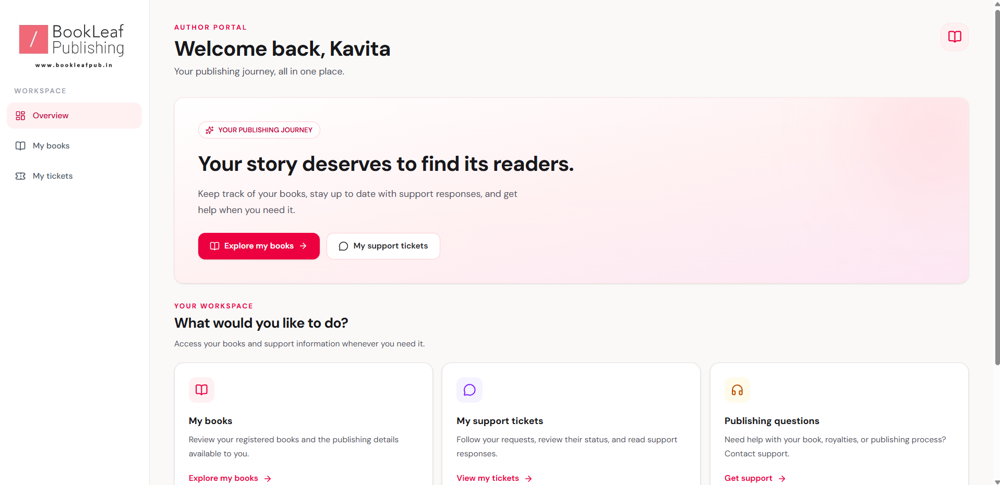
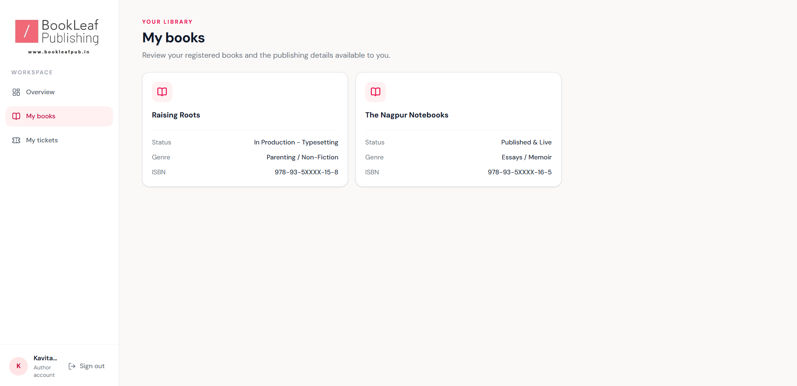
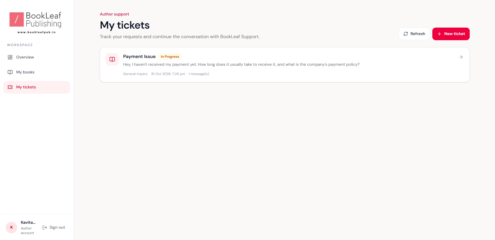
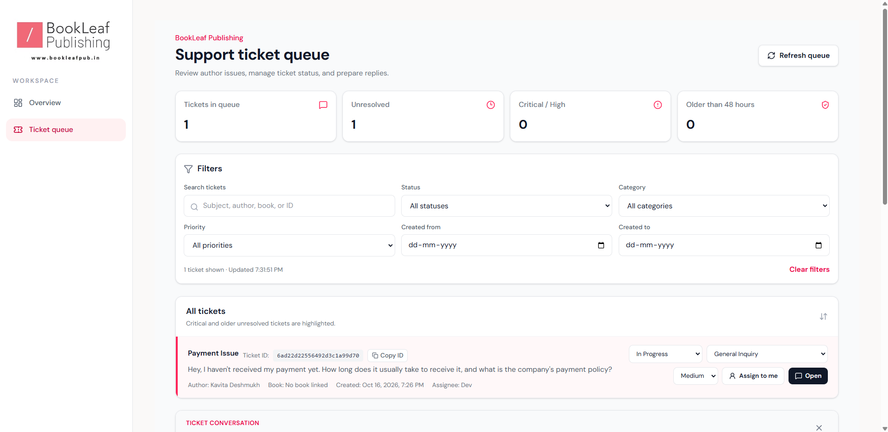

# BookLeaf Author Portal

A full-stack author support and ticket management platform designed to streamline communication between authors and the BookLeaf publishing operations team.

The application provides an author portal for managing books and support requests, alongside an administrative dashboard for handling tickets with AI-assisted classification, priority assessment, and response drafting.

---

# Live Demo

[**BookLeaf Author Portal**](https://YOUR-LIVE-DEMO-URL)

---

# Screenshots

### Login Page


### Author Dashboard



### My Books



### My Tickets



### Admin Ticket Queue



---

# Table of Contents

- [Overview](#overview)
- [Features](#features)
- [Technology Stack](#technology-stack)
- [System Architecture](#system-architecture)
- [Project Structure](#project-structure)
- [Getting Started](#getting-started)
- [Environment Variables](#environment-variables)
- [Running the Application](#running-the-application)
- [Available Scripts](#available-scripts)
- [API Documentation](#api-documentation)
- [Authentication and Authorization](#authentication-and-authorization)
- [Database Models](#database-models)
- [AI Integration](#ai-integration)
- [Real-Time Communication](#real-time-communication)
- [Database Seeding](#database-seeding)
- [Troubleshooting](#troubleshooting)
- [Security Considerations](#security-considerations)
- [Future Improvements](#future-improvements)

---

# Overview

BookLeaf Author Portal is a full-stack web application that helps authors communicate with publishing operations teams through a centralized support system.

Authors can access their dashboards, review book information, submit support tickets, and track ticket status. Administrators can manage incoming support requests through a dedicated dashboard.

The application integrates Google Gemini API services to support AI-assisted ticket processing. Its backend provides authentication, role-based access control, database operations, and API endpoints, while Socket.IO provides infrastructure for real-time communication.

The primary goal is to make author support more organized, improve ticket visibility, and reduce repetitive manual work.

---

# Features

### Author Portal

- User registration and login
- Protected author dashboard
- Book information and royalty-related details where available in the application data
- Support ticket creation
- Ticket status tracking
- Access to ticket conversations and responses
- Author-specific data access

### Admin Portal

- Dedicated administrative dashboard
- Centralized support ticket queue
- Ticket management and status updates
- Ticket categorization and priority handling
- AI-assisted ticket processing and response drafting
- Administrative access protected by role-based authorization

### AI-Assisted Support

- Google Gemini API integration
- AI-assisted ticket classification
- Priority assessment support
- AI-generated response drafts
- BookLeaf knowledge-base context for supported AI workflows
- Backend integration designed to keep API credentials out of frontend code

### Application Infrastructure

- REST API communication between the frontend and backend
- JWT-based authentication
- MongoDB database integration through Mongoose
- Socket.IO infrastructure for real-time events
- Environment-based configuration
- Separate frontend and backend applications

---

# Technology Stack

### Frontend

- **Core:** React, Vite, JavaScript
- **Styling:** Tailwind CSS
- **Routing:** React Router
- **Icons:** Lucide React

### Backend

- **Runtime:** Node.js
- **Framework:** Express
- **Database:** MongoDB, Mongoose
- **Authentication:** JSON Web Tokens (JWT), bcryptjs
- **Validation:** Zod

### AI and Real-Time Communication

- **AI Integration:** Google Gemini API through `@google/genai`
- **Real-Time Communication:** Socket.IO

### Development Tools

- **Linting:** ESLint
- **Development Server:** Nodemon

---

# System Architecture

The application follows a client-server architecture. The frontend communicates with the backend through REST APIs and Socket.IO. The backend handles authentication, application logic, database operations, and AI service integration.

### Architecture Diagram

```text
+--------------------------------+
|         React Frontend         |
|                                |
|  Author Portal                 |
|  Admin Dashboard               |
|  Login and Registration        |
+---------------+----------------+
                |
                | REST API / Socket.IO
                |
+---------------v----------------+
|        Express Backend         |
|                                |
|  Authentication Routes         |
|  Book Routes                   |
|  Ticket Routes                 |
|  Admin Routes                  |
|  Authentication Middleware     |
|  AI Services                   |
+-----------+-----------+--------+
            |           |
            |           |
+-----------v----+  +---v----------------+
|    MongoDB     |  | Google Gemini API  |
|                |  |                    |
|  Users         |  | AI-assisted ticket |
|  Books         |  | processing         |
|  Tickets       |  |                    |
+----------------+  +--------------------+
```

### Architecture Components

#### React Frontend

Provides the user interface for authors and administrators. It communicates with backend endpoints using the API helper and connects to the Socket.IO server for supported real-time functionality.

#### Express Backend

Processes incoming requests, applies authentication and authorization checks, coordinates application logic, and communicates with the database and AI services.

#### MongoDB

Stores persistent application data, including user accounts, books, and support tickets.

#### Google Gemini API

Supports AI-related functionality implemented in the backend, including ticket classification and response drafting.

#### Socket.IO

Provides the infrastructure for real-time communication between the frontend and backend.

---

# Project Structure

The following tree represents the application source files and relevant project configuration. Dependency folders, generated build output, and local environment files are excluded.

```text
bookleaf-author-portal/
├── .gitignore
├── README.md
├── client/
│   ├── .gitignore
│   ├── eslint.config.js
│   ├── index.html
│   ├── package.json
│   ├── package-lock.json
│   ├── vite.config.js
│   ├── public/
│   │   ├── bookleaf-logo.png
│   │   └── favicon.png
│   └── src/
│       ├── App.jsx
│       ├── index.css
│       ├── main.jsx
│       ├── components/
│       │   ├── AuthLayout.jsx
│       │   ├── Brand.jsx
│       │   ├── FormField.jsx
│       │   ├── LoadingState.jsx
│       │   └── ProtectedRoute.jsx
│       ├── context/
│       │   ├── AuthContext.js
│       │   ├── AuthContext.jsx
│       │   └── useAuth.js
│       ├── layouts/
│       │   ├── AdminLayout.jsx
│       │   └── AuthorLayout.jsx
│       ├── lib/
│       │   ├── api.js
│       │   └── socket.js
│       └── pages/
│           ├── NotFoundPage.jsx
│           ├── admin/
│           │   ├── AdminDashboard.jsx
│           │   └── TicketQueuePage.jsx
│           ├── auth/
│           │   ├── LoginPage.jsx
│           │   └── RegisterPage.jsx
│           └── author/
│               ├── AuthorDashboard.jsx
│               ├── MyBooksPage.jsx
│               └── MyTicketsPage.jsx
└── server/
    ├── package.json
    ├── package-lock.json
    ├── server.js
    ├── db.js
    ├── realtime.js
    ├── socket.js
    ├── seed.js
    ├── seed-admin.js
    ├── data/
    │   └── sample-data.json
    ├── middleware/
    │   └── auth.js
    ├── models/
    │   ├── Book.js
    │   ├── Ticket.js
    │   └── User.js
    ├── routes/
    │   ├── admin.routes.js
    │   ├── auth.routes.js
    │   ├── books.routes.js
    │   └── tickets.routes.js
    └── services/
        ├── bookleaf-knowledge-base.js
        ├── gemini.service.js
        └── ticket-ai.service.js
```

### Key Directories

- **`client/src/components/`** — Reusable interface components.
- **`client/src/context/`** — Authentication context and related hooks.
- **`client/src/layouts/`** — Author and administrator layouts.
- **`client/src/lib/`** — API and Socket.IO client utilities.
- **`client/src/pages/`** — Application pages organized by role.
- **`server/models/`** — Mongoose data models.
- **`server/routes/`** — Express API route definitions.
- **`server/middleware/`** — Authentication and authorization middleware.
- **`server/services/`** — AI integration and knowledge-base logic.
- **`server/data/`** — Sample data used by the application.

---

## Getting Started

### Prerequisites

Before setting up the application, make sure you have the following installed:

- **Node.js and npm:** [Download Node.js](https://nodejs.org/).
- **Git:** [Download Git](https://git-scm.com/).
- **MongoDB:** A local or hosted database.
- **Google Gemini API key:** Required for AI-assisted features.

Verify your Node.js and npm installations by running:

```bash
node --version
npm --version
```

### Installation

Follow these steps to install and configure the application.

**1. Clone the repository**

```bash
git clone https://github.com/sohelkhan-07/bookleaf-author-portal.git
```

**2. Navigate to the project directory**

```bash
cd bookleaf-author-portal
```

**3. Install frontend dependencies**

```bash
cd client
npm install
```

**4. Install backend dependencies**

```bash
cd ../server
npm install
```

**5. Configure environment variables**

Create the backend environment file at `server/.env` and the frontend environment file at `client/.env`.

Use the examples in the [Environment Variables](#environment-variables) section.

**6. Start the application**

Open two terminal windows from the project directory. Follow the instructions in [Running the Application](#running-the-application) to start the backend and frontend separately.

---

## Environment Variables

The application uses environment variables for configuration and sensitive credentials.

### Backend Configuration

Create a file named `.env` inside the `server/` directory.

Add the following configuration:

```dotenv
PORT=5000
CLIENT_URL=http://localhost:5173

MONGODB_URI=your_mongodb_connection_string
JWT_SECRET=your_long_random_jwt_secret
GEMINI_API_KEY=your_gemini_api_key

ADMIN_NAME=Your Admin Name
ADMIN_EMAIL=admin@example.com
ADMIN_PASSWORD=your_admin_password

SEED_AUTHOR_PASSWORD=your_test_author_password
```

#### Environment Variable Reference

- **`PORT`** — Port on which the backend server listens.
- **`CLIENT_URL`** — Frontend origin used for CORS configuration.
- **`MONGODB_URI`** — MongoDB connection string.
- **`JWT_SECRET`** — Secret used for signing and verifying JWTs.
- **`GEMINI_API_KEY`** — API key used by the Gemini integration.
- **`ADMIN_NAME`** — Administrator name used by the admin seed configuration.
- **`ADMIN_EMAIL`** — Administrator email used by the admin seed configuration.
- **`ADMIN_PASSWORD`** — Administrator password used by the admin seed configuration.
- **`SEED_AUTHOR_PASSWORD`** — Password used by the author seed configuration.

Replace the example values with your own configuration. The administrator and seed-related variables are relevant when running the corresponding seed scripts.

### Frontend Configuration

Create a file named `.env` inside the `client/` directory.

Add the following configuration:

```dotenv
VITE_API_URL=http://localhost:5000/api
```

The frontend uses this variable as the base URL for backend API requests. If it is not provided, the API helper defaults to `http://localhost:5000/api`.

**Security Note:** Only expose values intended for the browser through `VITE_` variables. Never put database credentials, JWT secrets, administrator passwords, or private API keys in frontend environment variables.

---

# Running the Application

The frontend and backend run as separate development processes. Start both services in separate terminal windows.

### Start the Backend

**1. Open a terminal at the project root.**

Navigate to the backend directory:

```bash
cd server
```

**2. Start the backend in development mode.**

```bash
npm run dev
```

Alternatively, start it without Nodemon:

```bash
npm start
```

The backend uses the configured `PORT`. With the example configuration, the server runs at `http://localhost:5000`.

### Start the Frontend

**1. Open a second terminal at the project root.**

Navigate to the frontend directory:

```bash
cd client
```

**2. Start the Vite development server.**

```bash
npm run dev
```

Vite normally serves the frontend at `http://localhost:5173`.

Open that address in your browser to access the application.

### Before Testing

Ensure that MongoDB is reachable, the environment files are configured, and the backend starts successfully before testing application features.

---

# Available Scripts

The project provides separate scripts for running, building, and checking the frontend and backend applications.

### Frontend Scripts

Run these commands from the `client/` directory.

- **`npm run dev`** — Starts the Vite development server.
- **`npm run build`** — Builds the frontend for production.
- **`npm run lint`** — Runs ESLint checks.
- **`npm run preview`** — Previews the production build locally.

### Backend Scripts

Run these commands from the `server/` directory.

- **`npm start`** — Starts the backend using Node.js.
- **`npm run dev`** — Starts the backend using Nodemon.

---

# API Documentation

The backend exposes REST API endpoints through Express. The frontend uses the API base URL configured by `VITE_API_URL`.

With the local example configuration, the base URL is:

```text
http://localhost:5000/api
```

### Authentication Routes

**Base path:** `/api/auth`

- **`POST /api/auth/register`** — Registers an author account. **Access:** Public.
- **`POST /api/auth/login`** — Authenticates a user. **Access:** Public.
- **`GET /api/auth/me`** — Retrieves the authenticated user's information. **Access:** Authenticated.

### Book Routes

**Base path:** `/api/books`

The book routes handle book-related requests. Consult `server/routes/books.routes.js` for the exact endpoint paths, HTTP methods, and access requirements.

### Ticket Routes

**Base path:** `/api/tickets`

- **`POST /api/tickets`** — Creates a support ticket. **Access:** Authenticated author.
- **`GET /api/tickets/my-tickets`** — Retrieves the author's tickets. **Access:** Authenticated author.
- **`GET /api/tickets/:id`** — Retrieves a ticket by ID. **Access:** Authenticated author.
- **`POST /api/tickets/:id/messages`** — Adds a message to a ticket. **Access:** Authenticated author.

The ticket routes apply authentication middleware. Additional authorization checks determine whether a user can perform a particular operation.

### Admin Routes

**Base path:** `/api/admin`

The admin routes provide administrative ticket and dashboard functionality. Review `server/routes/admin.routes.js` for the complete list of supported operations and their access requirements.

### Authentication Headers

Protected API requests use a bearer token in the `Authorization` header.

```http
Authorization: Bearer YOUR_JWT_TOKEN
```

The token is obtained through the authentication flow. Do not share real authentication tokens or include them in public documentation.

---

# Authentication and Authorization

The application uses JSON Web Tokens (JWT) for authentication and `bcryptjs` for password hashing.

The backend includes authentication middleware and role-based authorization. The user model defines the supported roles:

- `author`
- `admin`

Protected routes use middleware to verify the user's identity and, where required, their role.

Author-facing operations should be restricted to the authenticated author's own records, while administrative operations require the appropriate administrative permissions.

---

## Database Models

The backend uses MongoDB with Mongoose models.

### User

Represents application users and their roles. The role field supports `author` and `admin`.

### Book

Represents book-related information associated with the application and its users.

### Ticket

Represents an author's support request and its associated conversation.

**Ticket Statuses**

The ticket model includes the following status values:

- `Open`
- `In Progress`
- `Waiting for Author`
- `Resolved`
- `Closed`

**Ticket Priorities**

Priority values include:

- `Critical`
- `High`
- `Medium`
- `Low`

Ticket conversation messages distinguish between AI, author, and admin roles.

For the exact field definitions, validation rules, references, and default values, refer to the model files in `server/models/`.

---

# AI Integration

The backend integrates Google Gemini through the `@google/genai` package.

The relevant implementation is organized into the following service modules:

- **`server/services/gemini.service.js`** — Handles Gemini API integration.
- **`server/services/ticket-ai.service.js`** — Contains ticket-related AI processing.
- **`server/services/bookleaf-knowledge-base.js`** — Provides BookLeaf knowledge-base context for supported workflows.

The AI integration supports implemented workflows such as ticket classification, priority assessment, and response drafting.

AI output should be treated as assistance rather than an unquestionable decision. Administrators should review generated drafts before using them as final responses.

### API Quotas and Failures

Gemini requests can fail because of quota limits, rate limits, network issues, or provider errors. When this happens, AI-generated functionality may be unavailable until the underlying issue is resolved.

If a ticket is created successfully but the AI does not generate a response:

- Check the backend logs.
- Check the Gemini quota status.
- Verify that the ticket was saved successfully before assuming the entire operation failed.

Ticket persistence and AI processing are separate concerns, so verify the saved ticket rather than assuming the entire operation failed.

---

# Real-Time Communication

The application uses Socket.IO for real-time communication infrastructure.

The backend initializes Socket.IO alongside the HTTP server, and the frontend contains a Socket.IO client utility in `client/src/lib/socket.js`.

The client is configured to reconnect when the connection is interrupted. The exact events and workflows supported by real-time updates depend on the event handlers implemented in the frontend and backend.

### Relevant Files

For implementation details, review:

- `server/socket.js`
- `server/realtime.js`
- `client/src/lib/socket.js`


---

# Database Seeding

The backend includes seed scripts for preparing sample application data and administrator accounts.

### Relevant Files

- `server/seed.js`
- `server/seed-admin.js`
- `server/data/sample-data.json`

Review each script before running it to understand which records it creates or modifies and which environment variables it requires.

**Important:** Run seed scripts only against the intended database. Avoid running development seed scripts against a production database unless their behavior has been verified.

---

# Troubleshooting

### Frontend Cannot Reach the Backend

- Confirm that the backend is running.
- Verify `VITE_API_URL` in `client/.env`.
- Confirm that the URL includes the `/api` suffix.
- Restart the Vite development server after changing environment variables.

### MongoDB Connection Errors

- Verify that `MONGODB_URI` is correct.
- Ensure the database service is running or the hosted database is reachable.
- Check database network access and authentication settings.
- Review the backend terminal for connection errors.

### Authentication Errors

- Confirm that the login credentials are correct.
- Check that the backend has a valid `JWT_SECRET`.
- Verify that protected requests include a valid bearer token.
- Check whether the user's role permits the requested operation.

### AI Response Is Missing

- Check that `GEMINI_API_KEY` is configured on the backend.
- Review backend logs for Gemini API errors.
- Check whether the API quota or rate limit has been reached.
- Confirm that the ticket was saved successfully before retrying AI-related operations.

### Real-Time Updates Are Not Working

- Confirm that both frontend and backend are running.
- Check browser and backend logs for Socket.IO connection errors.
- Verify that the frontend connects to the correct backend origin.
- Check that the relevant event handlers are implemented and active.

---

# Security Considerations

Follow these practices to help protect the application and its data:

- Keep `.env` files out of version control.
- Never expose private API keys or database credentials in frontend code.
- Use a strong, unique JWT secret.
- Use appropriately hashed passwords rather than storing plaintext passwords.
- Protect private API routes with authentication and authorization middleware.
- Validate input on the backend.
- Restrict access to author-specific records.
- Review AI-generated responses before sending them to users.
- Use HTTPS and secure deployment configuration in production.
- Never commit real credentials, access tokens, or private connection strings.

---

# Future Improvements

Potential improvements for future versions include:

- More comprehensive API documentation.
- Automated backend tests and frontend integration tests.
- Improved monitoring and structured error reporting.
- More resilient AI processing with explicit retry and fallback behavior.
- Expanded administrative reporting and ticket analytics.
- Production deployment with secure environment configuration.
- More detailed accessibility and responsive-interface testing.